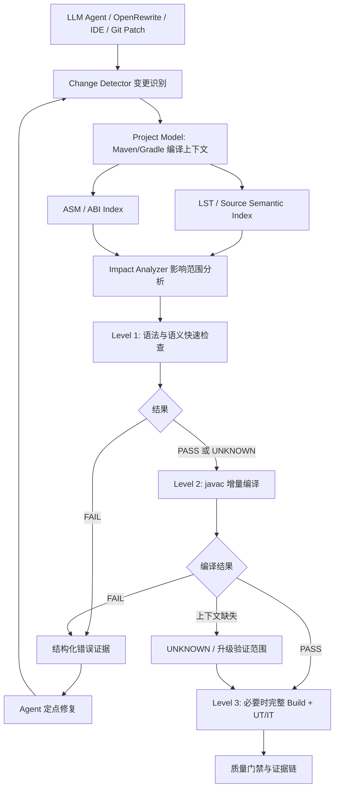

# Java 轻量级增量编译验证引擎技术设计方案

> 目标：参考 Moderne/Moddy 所体现的快速验证思路，自主建设面向 AI Coding Agent、OpenRewrite 重构及大规模 Java 工程的低成本编译验证能力。  
> 文档版本：v1.0  
> 日期：2026-11-10  
> 性质：自主技术方案；不是 Moderne 内部实现的准确复刻。

## 1. 背景与目标

在大型 Java 单体或多模块项目中，AI Agent 频繁修改源码，如果每次都执行 `mvn compile` 或 `gradle build`，会产生较高的等待时间和计算成本。希望实现“代码修改 → 快速验证 → 结构化反馈 → Agent 修复”的闭环，并通过增量编译和完整构建保障最终正确性。

### 1.1 建设目标

1. 根据 Git Diff、Agent Patch 或 OpenRewrite 修改记录精准识别变更文件。
2. 尽可能复用项目依赖、类型及 ABI 索引，减少重复工作。
3. 快速识别语法错误、类型解析失败、方法/字段引用错误等编译问题。
4. 在对外 API 变化时，覆盖必要的下游调用方与模块。
5. 将验证结果以结构化 JSON 输出给 Agent 自动修复。
6. 在轻量验证无法确认时明确返回 `UNKNOWN`，并通过真实增量编译或完整构建兜底。

### 1.2 非目标

- 不从零实现 Java 编译器。
- 不把静态验证结果等同于完整工程可编译。
- 不把 Java 编译通过等同于 Spring 装配、SQL、运行时行为或业务逻辑正确。
- 不把 Methode Call Graph 当成唯一的增量编译依赖依据。

## 2. 总体架构



**职责分离：**

| 组件 | 职责 | 推荐技术 |
|---|---|---|
| Change Detector | 变更文件、增删改方法、内容哈希、版本识别 | Git Diff / Agent Patch |
| Project Model | JDK、编译参数、模块依赖、Classpath、Source Set | Maven Resolver、Maven Model、Gradle Tooling API |
| Source Semantic Index | 类、字段、方法、类型归属、调用位置 | OpenRewrite LST |
| ABI Index | 编译后类的可访问成员、签名、继承、泛型等 | ASM |
| Impact Analyzer | 变化对调用方、子类、模块的影响 | 反向类型依赖图、符号引用索引 |
| Fast Verifier | 快速筛查语法与类型问题 | OpenRewrite + 自定义规则 |
| Compile Verifier | 根据真实编译上下文验证选定源码 | JDK JavaCompiler API |
| Cache | 类型、ABI、依赖和验证上下文缓存 | RocksDB/SQLite（单机优先） |
| Agent Adapter | 统一诊断、修复建议、回调、证据链 | Java API / JSON |

## 3. 技术路线与基本原则

### 3.1 核心技术组合

**OpenRewrite LST + ASM + JavaCompiler API + 增量影响分析**。

- **LST**：理解源码结构和已有类型归属，定位变更元素和引用关系。
- **ASM**：从 `.class`/JAR 提取已经编译完成的依赖接口信息，避免反复解析大量依赖源码。
- **JavaCompiler API**：使用真实 `javac` 执行选定源码的编译验证，避免自研完整 Java 类型系统。
- **反向依赖索引**：当公开方法签名、字段、父类等变化时扩展验证范围。

> 重要限制：ABI 不能替代源码级完整语义分析；已有 LST 类型归属可能因为变更后的代码、Classpath 或依赖版本改变而失效，必须刷新或标记未知。仅编译被修改文件也可能漏掉受影响的调用方。

### 3.2 分层验证

| 层次 | 检查内容 | 触发策略 | 通过的含义 |
|---|---|---|---|
| L1 快速静态检查 | 可解析性、类型归属、部分符号与规则检查 | 每次变更 | 未发现当前规则覆盖的错误，**不等于编译通过** |
| L2 增量 javac | 变更文件与必要影响文件的真实编译 | L1 后或按策略触发 | 选定编译范围与环境下通过 |
| L3 完整项目验证 | Maven/Gradle、注解处理、UT/IT、Spring 启动与业务回归 | 合并前/高风险变更 | 满足对应工程质量门禁 |

建议从 L2 的最小可行版本开始建设，而非第一天就实现复杂语义引擎。

## 4. 项目初始化与语义索引

### 4.1 初始化流程

1. 识别 Maven/Gradle 工程及模块拓扑。
2. 获取各模块的 `sourceRoots`、`testSourceRoots`、JDK 版本、编译参数、Classpath/Modulepath。
3. 对已有源码建立 LST/语义索引；记录类、方法、字段、引用和源码位置。
4. 扫描 `target/classes`、`build/classes` 和依赖 JAR，提取 ABI。
5. 构建类型引用、继承/实现、方法调用等反向关系。
6. 生成索引快照并记录版本、构建参数和哈希。

### 4.2 数据索引

```text
SourceIndex
  file -> package, classes, symbols, line/column, contentHash
TypeIndex
  class -> extends, implements, genericSignature, accessFlags
MethodIndex
  method -> declaringType, signature, returnType, parameterTypes
ReferenceIndex
  symbol -> referencing files and positions
CallGraph
  caller -> callee (可解析的静态调用关系)
AbiIndex
  artifact/class -> members and public/protected signatures
```

应优先构建**符号引用与类型依赖索引**，而不只是方法调用图：继承、接口、字段、注解与生成代码都可能改变编译受影响范围。

### 4.3 缓存 Key 与失效

```text
SourceSemanticKey = sourceHash + languageLevel + classpathHash + compilerOptionsHash
AbiKey            = artifactCoordinates + classBytecodeHash + targetJdkVersion
DependencyKey     = projectModelHash + semanticIndexVersion
```

失效策略：

- 文件内容变化：刷新文件语义及其出入引用边。
- Classpath、JDK、编译选项变化：失效相关语义索引。
- ABI 变化：刷新相关类的接口和反向依赖分析。
- POM/Gradle、插件、生成代码目录变化：重新解析受影响项目模型；必要时升级为模块级编译。
- 缓存缺失或版本冲突：返回 `UNKNOWN`，不要当作源码错误。

## 5. ASM ABI 提取

### 5.1 最小 ABI 模型

```json
{
  "className": "com.demo.OrderRepository",
  "superName": "java.lang.Object",
  "accessFlags": 1,
  "interfaces": [],
  "methods": [
    {
      "name": "save",
      "descriptor": "(Lcom/demo/Order;)Lcom/demo/Order;",
      "signature": null,
      "accessFlags": 1
    }
  ],
  "fields": []
}
```

建议提取：类/接口/注解/枚举类型、访问修饰符、父类、接口、方法描述符、泛型 Signature、字段、常量、构造方法、异常声明、相关注解、内部类、默认接口方法、桥接方法、Record/Sealed 元数据等。

### 5.2 ASM 基础代码示例

```java
import org.objectweb.asm.*;
import java.io.IOException;
import java.nio.file.Files;
import java.nio.file.Path;

public class AbiScanner {
    public static void scan(Path classFile) throws IOException {
        byte[] bytes = Files.readAllBytes(classFile);
        ClassReader reader = new ClassReader(bytes);
        reader.accept(new ClassVisitor(Opcodes.ASM9) {
            @Override
            public void visit(int version, int access, String name,
                              String signature, String superName, String[] interfaces) {
                System.out.println("TYPE " + name + " extends " + superName);
            }

            @Override
            public MethodVisitor visitMethod(int access, String name,
                                             String descriptor, String signature,
                                             String[] exceptions) {
                if ((access & (Opcodes.ACC_PUBLIC | Opcodes.ACC_PROTECTED)) != 0) {
                    System.out.println("METHOD " + name + descriptor);
                }
                return null;
            }
        }, ClassReader.SKIP_CODE | ClassReader.SKIP_DEBUG | ClassReader.SKIP_FRAMES);
    }
}
```

该示例只展示提取入口，不是完整的 ABI 兼容性判断；实际还需考虑包级可见性、同包调用、泛型、常量内联及编译器生成元素。

## 6. OpenRewrite LST 语义信息提取

OpenRewrite 用于变更定位、语义索引与规则筛查。关键是保证 Parser 使用真实构建 Classpath。

### 6.1 方法调用访问示例

```java
@Override
public J.MethodInvocation visitMethodInvocation(J.MethodInvocation method,
                                                 ExecutionContext ctx) {
    J.MethodInvocation m = super.visitMethodInvocation(method, ctx);
    JavaType.Method methodType = m.getMethodType();
    if (methodType == null) {
        reportUnknown(m, "无法解析方法类型");
        return m;
    }
    JavaType.FullyQualified owner = methodType.getDeclaringType();
    if (owner == null) {
        reportUnknown(m, "无法解析声明类型");
        return m;
    }
    recordCall(owner.getFullyQualifiedName(),
               methodType.getName(),
               methodType.getParameterTypes(),
               methodType.getReturnType());
    return m;
}
```

> 上述是放在自定义 `JavaIsoVisitor` 中的示意代码，`reportUnknown` 和 `recordCall` 需要自行实现。`methodType != null` 也不能直接证明修改后的调用合法，尤其在类型缓存过期时。

### 6.2 优先实现的规则

| 规则 | 实现手段 | 置信度 |
|---|---|---|
| 语法可解析 | 重新解析变更源码 | 高 |
| 类型是否可定位 | LST 类型信息 + 符号索引 | 中～高，依赖 Classpath |
| 方法/字段是否可解析 | JavaType + ABI 索引 | 中～高 |
| 参数及返回值检查 | 类型归属 + Javac 兜底 | 静态规则不能覆盖全部边界 |
| 泛型、重载、访问权限 | 优先交由 Javac | 高（真实编译上下文下） |
| Lombok/MapStruct 生成代码 | 保留注解处理上下文或升级验证 | 不能仅靠 `-proc:none` |

## 7. JavaCompiler API 增量编译

### 7.1 最小实现示例

```java
import javax.tools.*;
import java.io.IOException;
import java.nio.file.Path;
import java.util.List;

public class IncrementalJavacVerifier {
    public static boolean verify(List<Path> changedJavaFiles,
                                 String classpath,
                                 Path temporaryOutputDir) throws IOException {
        JavaCompiler compiler = ToolProvider.getSystemJavaCompiler();
        if (compiler == null) {
            throw new IllegalStateException("当前运行环境缺少 JDK Compiler");
        }
        DiagnosticCollector<JavaFileObject> diagnostics = new DiagnosticCollector<>();
        try (StandardJavaFileManager fileManager =
                     compiler.getStandardFileManager(diagnostics, null, null)) {
            Iterable<? extends JavaFileObject> sources =
                    fileManager.getJavaFileObjectsFromPaths(changedJavaFiles);
            List<String> options = List.of(
                    "--release", "17",
                    "-proc:none",
                    "-implicit:none",
                    "-classpath", classpath,
                    "-d", temporaryOutputDir.toString()
            );
            boolean success = Boolean.TRUE.equals(
                    compiler.getTask(null, fileManager, diagnostics,
                            options, null, sources).call());
            for (Diagnostic<? extends JavaFileObject> d : diagnostics.getDiagnostics()) {
                System.out.printf("%s %s:%d:%d %s%n",
                        d.getKind(), d.getSource(), d.getLineNumber(),
                        d.getColumnNumber(), d.getMessage(null));
            }
            return success;
        }
    }
}
```

### 7.2 实际生产所需补充

- 保证 `temporaryOutputDir` 已创建、可写，使用 Workspace 隔离。
- 同一批互相引用的变更源码一起传入编译，不要逐文件孤立验证。
- 传入精确的 JDK 目标版本、Classpath、Modulepath、源码路径、字符编码及相关编译选项。
- JavaCompiler 可能因为依赖/生成源码缺失报错；需要与真正的代码错误区分。
- `-proc:none` 会禁用注解处理器：对 Lombok、MapStruct 等场景需要配置专门通道或升级构建。
- `-implicit:none` 并不意味着所有隐式依赖问题都被自动解决。
- 编译使用旧 class 时，必须通过影响分析补充 ABI 变化影响的调用方，或升级为模块级编译。

## 8. 影响范围分析

### 8.1 变化级别

| 变化级别 | 例子 | 建议验证策略 |
|---|---|---|
| L0 仅方法体变化 | 修改局部计算逻辑 | 变更文件为主，考虑内联/常量及工具链特殊情况 |
| L1 私有成员变化 | 私有方法签名修改 | 当前类及文件内使用点 |
| L2 外部接口变化 | public/protected 方法、字段、构造器变化 | 变更文件 + 反向引用方 + 相关子类 |
| L3 类型层级变化 | 父类、接口、泛型上界变化 | 扩展类型层级和模块级编译 |
| L4 工程构建变化 | JDK、依赖、POM、注解处理器变化 | 重建项目模型，升级模块/全量验证 |

### 8.2 基础算法（伪代码）

```java
Set<FileId> affected = new HashSet<>(changedFiles);
Queue<SymbolId> queue = new ArrayDeque<>(changedPublicSymbols);
Set<SymbolId> visited = new HashSet<>();

while (!queue.isEmpty()) {
    SymbolId changed = queue.remove();
    if (!visited.add(changed)) continue;

    for (Reference ref : reverseIndex.findReferences(changed)) {
        affected.add(ref.sourceFile());
        if (ref.mayPropagateApiChange()) {
            queue.add(ref.enclosingExportedSymbol());
        }
    }
}

if (hasUnknownEdges || changedBuildModel || processorGeneratedSourcesChanged) {
    upgradeVerificationScope();
}
```

**安全约束：**反向依赖图是编译范围裁剪的优化手段，不是完整正确性证明。图缺边、动态生成源码、常量内联、注解处理、模块边界等情况须升级验证。

## 9. Agent 反馈协议

### 9.1 验证状态

| 状态 | 解释 | 后续动作 |
|---|---|---|
| `PASS` | 当前验证层级和范围内通过 | 进入下一门禁 |
| `FAIL` | 确认发现编译错误 | Agent 定点修复 |
| `UNKNOWN` | 依赖/类型信息不足，或超出能力覆盖 | 扩大范围或升级编译 |
| `INFRA_ERROR` | 验证环境、服务或工具异常 | 重试/人工介入 |

### 9.2 JSON 示例

```json
{
  "verificationId": "verify-001",
  "workspaceId": "ws-001",
  "commitId": "abc123",
  "changeId": "change-001",
  "status": "FAIL",
  "verificationLevel": "L2",
  "verificationScope": ["order-service/src/main/java/com/demo/OrderService.java"],
  "diagnostics": [
    {
      "file": "order-service/src/main/java/com/demo/OrderService.java",
      "line": 35,
      "column": 18,
      "errorCode": "METHOD_NOT_FOUND",
      "element": "orderRepository.saveOrder(order)",
      "message": "Cannot resolve method saveOrder(Order)",
      "declaringType": "com.demo.OrderRepository",
      "possibleCandidates": ["save(Order)"]
    }
  ],
  "attribution": {
    "agent": "coding-agent-01",
    "recipeId": null
  }
}
```

`possibleCandidates` 和根因解释可提供给 Agent，但需要明确区分确定的诊断、候选建议和 LLM 推测，避免把修复建议当成事实。

### 9.3 自动修复闭环

1. Agent 提交 Patch 与变更范围。
2. 验证引擎计算当前 Workspace 的真实内容哈希。
3. 执行 L1、L2 验证，输出带源码位置的诊断。
4. Agent 只修复相关错误，不得无约束重写整个模块。
5. 再次验证；同类错误连续重复超过阈值则停止并升级评审。
6. 保留变更、诊断、修复、验证级别及最终构建结果形成证据链。

### 9.4 基础 HTTP 接口（建议）

```text
POST /api/verifications
GET  /api/verifications/{verificationId}
GET  /api/verifications/{verificationId}/diagnostics
POST /api/verifications/{verificationId}/cancel
```

请求至少包含 `workspaceId`、`revision/commitId`、`changeId`、`projectModelVersion`、变更文件列表和目标验证级别；结果必须声明实际覆盖范围。

## 10. 高并发与低成本优化

### 10.1 执行策略

- 同一 Agent 高频编辑可短时间合并变更，但对最新版本结果保持一致性。
- 多 Agent 采用不同 Git Worktree/独立构建输出与缓存命名空间。
- 当文件出现新版本时取消旧任务，避免过期诊断污染当前修复流程。
- 热缓存下才讨论低延迟目标；首次全项目索引与冷启动应独立统计。

### 10.2 性能度量

| 指标 | 目标及判断标准 |
|---|---|
| 验证耗时 P50/P95 | 与真实模块/全量构建对比，分冷/热缓存 |
| CPU 时间与内存峰值 | 相同变更集下比较资源消耗 |
| 缓存命中率 | 区分 LST、ABI、项目模型 |
| 编译错误检出率 | 以真实 Maven/Gradle 编译为对照 |
| 漏报率 | 重点监控，不能为追求速度而牺牲正确性 |
| 误报率 | 区分源码错误与环境配置缺失 |
| 影响范围召回率 | 变更 ABI 后应覆盖必要调用方 |
| Agent 修复成功率 | 修复后真实编译通过比例 |

> 不建议在尚未测量真实项目之前承诺“毫秒级”或“计算成本降低 N%”。

## 11. 关键风险与应对

| 风险 | 影响 | 应对 |
|---|---|---|
| LST 类型信息过期 | 虚假 PASS/FAIL | 缓存版本化，变更后重归属，异常返回 UNKNOWN |
| 旧编译产物与源码不一致 | 漏检调用方错误 | ABI 对比 + 影响范围扩展 |
| 注解处理器生成代码 | 非真实编译环境 | 指定处理器通道或模块级构建 |
| 依赖/ClassPath 不完整 | 虚假代码错误 | 校验真实构建上下文，分类错误 |
| 反向图不完整 | 漏报 | 影响范围不确定时扩大至模块或全量 |
| Java 泛型/重载/模块访问复杂 | 自定义语义检查遗漏 | 使用 Javac 作为编译判定核心 |
| 多 Agent 并发修改 | 诊断串线、文件覆盖 | Workspace + Revision 隔离 |
| Maven/Gradle 插件副作用 | 增量编译与真实构建不一致 | L3 保留完整构建门禁 |

## 12. 工程目录设计

```text
lightweight-compile-engine/
├── compile-api/
│   ├── VerificationRequest.java
│   ├── VerificationResult.java
│   └── Diagnostic.java
├── project-model/
│   ├── MavenProjectResolver.java
│   ├── GradleProjectResolver.java
│   └── ClasspathManager.java
├── lst-engine/
│   ├── JavaParserManager.java
│   ├── SemanticExtractor.java
│   └── SymbolReferenceIndex.java
├── abi-engine/
│   ├── AsmClassScanner.java
│   ├── AbiExtractor.java
│   └── AbiIndex.java
├── dependency-engine/
│   ├── TypeDependencyGraph.java
│   ├── ReferenceGraph.java
│   └── ImpactAnalyzer.java
├── verification-engine/
│   ├── FastStaticVerifier.java
│   ├── JavacIncrementalVerifier.java
│   └── VerificationPolicy.java
├── cache-engine/
│   ├── SemanticCache.java
│   ├── AbiCache.java
│   └── ProjectModelCache.java
├── agent-adapter/
│   ├── ErrorNormalizer.java
│   └── AgentCallback.java
└── verification-server/
    ├── VerificationController.java
    └── VerificationScheduler.java
```

## 13. 分期实施计划

### P1：MVP —— 先跑通真实编译验证

- Git Diff 识别变化文件。
- 解析一个 Maven 多模块 Java 项目的真实编译 Classpath。
- JavaCompiler 编译一批变更文件，诊断以 JSON 输出。
- 基础 Agent 修复循环。
- `UNKNOWN`/`INFRA_ERROR` 与编译错误分离。

**验收：**可在真实 Maven 多模块工程中，对普通源码改动输出可靠的真实 Javac 诊断；发现环境缺失时不误判。

### P2：LST 与 ABI 增量索引

- OpenRewrite LST、类型与方法引用提取。
- ASM ABI 索引及缓存。
- API 变化对比和缓存失效。

**验收：**方法体与公开签名变化能被区分；能定位主要直接引用方。

### P3：安全的影响范围分析

- 反向类型依赖/引用图。
- 变更影响传播。
- 子类、泛型、字段、接口变化覆盖。
- 不确定范围自动升级模块编译。

**验收：**在一组有代表性的接口变更用例上，受影响调用方不漏检。

### P4：多 Agent + 企业级门禁

- Workspace 隔离、并发调度、取消过期任务。
- JSON 错误证据链、自动修复上限、仲裁升级。
- 完整构建、UT/IT 和质量报告。

**验收：**自动修复后必须由 L2/L3 证明当前版本通过，形成可追溯证据。

## 14. POC 测试矩阵

| 用例 | 预期层级 | 期望行为 |
|---|---|---|
| 方法体局部逻辑修改 | L1+L2 | 当前文件快速验证 |
| 删除被调用的 public 方法 | L2+影响分析 | 发现引用方报错 |
| 修改方法参数与返回值 | L2+影响分析 | 覆盖重载与调用位置 |
| 父类/接口签名变更 | L2/L3 | 验证实现类与子类 |
| 泛型上界调整 | L2/L3 | 检查类型约束 |
| 修改 Maven 依赖版本 | L3 | 重新生成项目模型并扩大范围 |
| Lombok/MapStruct 项目 | L2 专项/L3 | 避免因禁用处理器造成假阳性 |
| 缺失依赖 JAR | UNKNOWN | 不将环境问题判定为源码错误 |
| 多 Agent 同时修改同文件 | 并发测试 | 不混淆版本与诊断 |

## 15. 推荐实施优先级与结论

**第一优先级：**`Maven 项目模型 + JavaCompiler API + 结构化诊断`，先形成可工作的最小闭环。  
**第二优先级：**`OpenRewrite LST + ASM ABI + 变更缓存`，优化变更定位和重复计算成本。  
**第三优先级：**`反向依赖图 + 安全扩大验证范围`，提升跨文件/跨模块错误覆盖。  
**第四优先级：**`多 Agent 调度 + 证据链 + 完整构建/测试门禁`，形成工程级质量保障。

最终推荐形成两个可复用子平台：

1. **代码语义分析平台**：维护全项目的类型、调用关系、符号引用和 ABI 索引。
2. **即时编译验证平台**：接收变更、计算影响范围、快速验证、反馈 Agent、触发升级门禁。

**结论：**不要追求以自定义规则完全替代 Javac；真正可落地的低成本路径是“语义索引定位 + ABI 缓存 + 安全裁剪 + 真实增量编译 + 完整构建兜底”。

## 16. 参考资料与实现入口

以下为用于自主研发的官方技术入口；实际使用前应根据项目固定和核对具体版本。

- OpenRewrite 官方文档：https://docs.openrewrite.org/
- OpenRewrite 项目源码：https://github.com/openrewrite/rewrite
- ASM 项目：https://asm.ow2.io/
- JavaCompiler API（JDK 17）：https://docs.oracle.com/en/java/javase/17/docs/api/java.compiler/javax/tools/JavaCompiler.html
- Maven Resolver：https://maven.apache.org/resolver/
- Gradle Tooling API：https://docs.gradle.org/current/userguide/embedding.html
- Moderne 官方站点：https://www.moderne.ai/

> **关于 Moderne 能力的边界说明：**本方案借鉴轻量验证及 ABI/语义分析思路，未声称取得或复刻 Moderne 内部私有实现。公开产品能力及实现细节应以 Moderne 当前官方文档为准。
